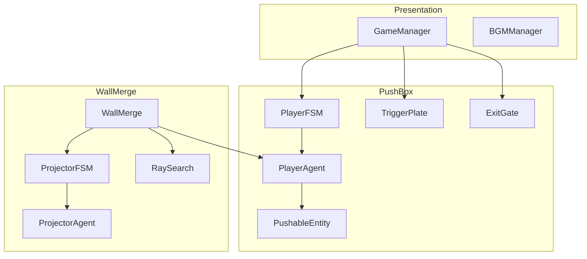
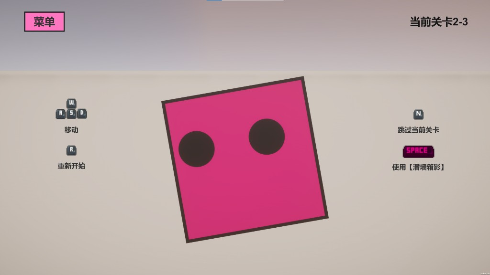

# 潜墙箱影

<p align="center">
  
</p>

**HDRP 3D 推箱解谜游戏**：玩家在三维格子上推箱、踩压力板开门；贴墙按 Space 融合进墙面，沿 2D 面心跑道移动后复原回 3D，用二维位移改写三维推箱局面。

工程目录名 `HDRP_ReversionBox`。作品路径：2026 Global Game Jam（主题 Mask）原型 → 机核 BooomJam 扩展至 26 关 → 机核核聚变以 HitAcademy 参展商身份出展。

[](https://www.bilibili.com/video/BV1xkLM66ENw)

---

## 技术栈


| 类别 | 实际使用 |
|------|----------|
| 引擎 | Unity 2022.3.62f3 |
| 渲染 | HDRP 14.0.12（Volume DOF / Zoom、Decal 投影） |
| 相机 | Cinemachine 2.10.3（`gameCam` / `wallCam` 双机位 + Impulse） |
| 动画 | DOTween（`Assets/Plugins/Demigiant/DOTween/`，非 UPM） |
| UI / 文本 | uGUI、TextMeshPro 3.0.7 |
| 输入 | Legacy Input（`Input.GetAxisRaw` / `GetKeyDown`） |

`Packages/manifest.json` 中的 Cursor IDE、MCP For Unity 仅用于编辑器协作，运行游戏不依赖。

---

## 核心特性

1. **`WallMerge` 编排的 3D↔2D 切换**  
   `WallMerge.Transition` 用 DOTween `Sequence` 串起双相机切换、`dofVolume` / `zoomVolume` 权重、粒子、Decal 开关与输入锁。融合时玩家沿墙法线压扁并吸附到 `RaySearch.faceCentersXZ` 最近面心。

2. **`RaySearch` 面心跑道**  
   编辑器烘焙墙面离散点；运行时按最近点索引导航。`ProjectorAgent` 用点积判断直行或转角：凹角射线 + `LineLineIntersection` 求枢轴旋转，求交失败则吸附到目标，避免 `ProjectorRotate` 卡死。

3. **复原推箱与正向推箱对称**  
   3D 侧 `PlayerAgent.TryPlaneMove` 只推 `YellowBox` 链；复原侧 `CanRevertAt` / `TryRevertMove` / `RecoverCanPush` 同时处理 `YellowBox` 与 `BlueBox`。`PushableEntity` 递归探测前方格子后再从远端到近端执行 `Move`。

4. **双 FSM + 接口解耦**  
   自研 `StateMachine`（`AI.Base`）。`PlayerFSM : PlayerAgent` 管平面待机/移动；`ProjectorFSM : ProjectorAgent` 管墙面待机/移动/旋转。`IPlayerAgent`、`IProjectorAgent`、`IMergeController` 让 `WallMerge` 只依赖接口。

5. **关卡流程与防速通**  
   `GameManager` 收集 `TriggerPlate`，全板按下后 `ExitGate.OpenGate()`。`winUnlockDelay` + `CanWinNow()` 延迟胜利判定；`OnTriggerStay` 才触发 `Win()`，避免刚开门就瞬切下一关。

6. **相机遮挡抖动**  
   `CameraOcclusionDither` + `HDRPDitherUnlit.shader`：相机到玩家射线命中 `Wall` 时替换材质。`RaycastNonAlloc`、`checkInterval` 降频、Collider→Renderer 缓存，`OnDisable` 还原原始材质。

7. **展向体验与编辑器绑定**  
   `BGMManager` 按 Build Index 阈值切曲并 crossfade。`GameManagerEditor` 按按钮名自动绑定关卡、菜单、退出（`LoadLevelByIndex` / `ToggleMenu` / `QuitGame`）。

---

## 架构设计

### 模块划分

```
Assets/Scripts/
  WallMerge/            维度切换、射线选墙、投影器
  PushBox/              3D 移动、推箱、压力板、出口
  FiniteStateMachine/   玩家 / 投影器状态机
  Presentation/         GameManager、BGM、材质帧动画
  Camera/               遮挡抖动
Assets/Editor/
  GameManagerEditor.cs  关卡按钮自动绑定
```

当前 HEAD 是展会回归版。Git 历史上的 `GridBoard` 占格系统已在提交 `25f753d` 移除，**不在现行架构中**。`PlayerMovement.cs` 是早期并行实现，**未挂在 `Player.prefab` 上**；运行时路径是 `PlayerFSM` → `PlayerAgent`。

### 依赖关系



玩法闭环：3D 推箱 → 贴 `Wall` 层按 Space → `ToRaySearch` 取 `RaySearch` → `WallMerge` 切 2D → `ProjectorFSM` 沿面心移动/旋转 → Space 复原 → `TryRevertMove` 把 2D 位移写成 3D 推箱链。

### 关键设计决策

**1. OverlapBox + LayerMask 离散移动，不用 Rigidbody 推挤**

推箱谜题要确定性的一格一步和可预测的链式推动。`PlayerAgent.TryPlaneMove` 用 `Physics.OverlapBox`（半边长 0.4）配合 `blockingLayer` 判定空格 / 黄箱 / 阻挡。

权衡：关卡必须按格子对齐，Layer（`Player` / `YellowBox` / `BlueBox` / `Wall`）配错会整关失效；没有连续物理碰撞的「真实感」。

**2. 接口 + 轻量 FSM，`WallMerge` 作编排者**

维度切换要同时关掉 3D 玩家、打开投影器、播时间轴。`IMergeController` / `IPlayerAgent` / `IProjectorAgent` 避免 `WallMerge` 直接依赖具体 MonoBehaviour 类型。状态机只做「读输入 → 请求 → 执行」，细节留在 Agent。

权衡：`WallMerge` 注释写明「PA && PSNA 不优雅」——仍靠 `cooldown`、`LockInput`、`m_canAcceptInput` 手工防抢输入，不是事件总线。

**3. 预烘焙 `RaySearch.faceCentersXZ`，运行时只做最近点索引**

墙面 2D 导航需要稳定离散点；编辑器烘焙可在 Scene 里用 Gizmo 调面心。运行时 `GetClosestFaceCenterIndex` + 索引环绕即可。

权衡：改墙几何必须重新烘焙。`RaySearch.cs` 顶部 `using UnityEditor`，烘焙写回场景；做 Player 构建时要把 Editor API 与运行时拆开（见下方踩坑）。

### 设计模式（仅列实装）

| 模式 | 位置 | 为什么用 |
|------|------|----------|
| 状态机 | `StateMachine`、`PlayerFSM`、`ProjectorFSM` | 待机 / 移动 / 旋转互斥，避免 `Update` 里堆条件 |
| 单例 | `GameManager.Instance`、`BGMManager` | 关卡流程、SFX、跨场景 BGM 的全局入口 |
| 接口隔离 | `IPlayerAgent`、`IProjectorAgent`、`IMergeController` | 维度切换编排不绑死具体组件 |

未使用对象池、事件总线、ECS。

---

## 演示

[**【潜墙箱影】演示攻略视频**](https://www.bilibili.com/video/BV1xkLM66ENw) — 玩法流程与关卡思路，适合快速建立认知。



*展版 HUD：左上菜单（`GameManager.ToggleMenu`）；右上当前关卡；WASD 移动；R 重开；N 跳关；Space 使用【潜墙箱影】（`WallMerge` 融合 / 复原）。*

<!-- 可选：补充 15–30s GIF（3D 推箱 → Space 融合 → 墙面移动 → 复原推箱） -->

---

## 运行方式

### 环境

1. 安装 [Unity Hub](https://unity.com/download) 与 **Editor 2022.3.62f3**（与 `ProjectSettings/ProjectVersion.txt` 一致）。
2. Clone 本仓库，用 Hub **Open** 项目根目录（含 `Assets/`、`Packages/`、`ProjectSettings/`）。
3. 首次打开等待 UPM 解析 HDRP / Cinemachine。若 DOTween 报错：菜单 **Tools → Demigiant → DOTween Utility Panel → Setup DOTween**。
4. **File → Build Settings** 确认 `Assets/Scenes/Lv1.unity` 在列表首位（当前启用 **Lv1–Lv27**）。
5. 打开 `Lv1`，按 Play。

`*chen*`、`Lv2626` 等场景是开发/测试关，不在 Build Settings 主链里。

### 操作

| 按键 | 行为 | 代码入口 |
|------|------|----------|
| WASD / 方向键 | 四向移动，禁止斜向 | `PlayerAgent.ReadPlaneMoveInput` |
| Space | 贴墙时融合进墙面；2D 面内再次 Space 尝试复原 | `WallMerge.HandleMergeInput` / `ProjectorAgent.HandleRevertTo3D` |
| ← / → | 2D 面沿 `faceCentersXZ` 移动或转角 | `ProjectorAgent.ReadInput` |
| R | 重载当前关 | `GameManager.Update` |
| N | 加载下一 Build 场景（试玩/调试） | `GameManager.Update` |
| 菜单按钮 | 开关关卡选择 UI | `GameManager.ToggleMenu` |

复原时若落点被箱子占满且无法链式推开，播放 `GameSFX.FailAciton` 并留在墙上。

### Layer 依赖

`ProjectSettings/TagManager.asset` 自定义层：`YellowBox`、`BlueBox`、`Wall`、`Player`。推箱、复原、贴墙检测都依赖这些 Layer，不要随意改名。

---

## 性能优化 / 踩坑记录

### 做过的处理

- **遮挡检测降本**：`CameraOcclusionDither` 用 `RaycastNonAlloc`（`MaxHits = 64`）+ `checkInterval`（默认 0.05s）+ Collider→Renderer 字典缓存，避免每帧 `GetComponentsInChildren`；退出时 `RestoreAllRenderers`。
- **融合/复原抢输入**：`WallMerge.cooldown`、`ProjectorAgent.cooldown`、`PlayerAgent.LockInput`、`EnableInput(merge)` 四层闸门，防止刚融合立刻复原、或复原瞬间 3D FSM 吃到残留轴值。
- **转角求交失败**：`LineLineIntersection` 失败时直接把投影器吸附到 `m_targetPos` 并清 `m_isMoving`，避免旋转状态永远不结束。
- **通关延迟**：`winUnlockDelay` 防止压力板刚齐、门刚开就 `OnTriggerStay` 切关。

### 踩过的坑 / 已知限制

- **复原位占满**：`HandleRevertTo3D` 先 `TryRevertAt`，失败只播 `FailAciton` 并 `Debug.Log`，玩家仍停在墙上。这是玩法规则，不是崩溃。
- **`AnimatedMaterial` 换材质**：`meshRenderer.material = materials[frame]` 会实例化材质。展会体量可接受；关卡对象再多需要改成 `sharedMaterial` 或 MaterialPropertyBlock。
- **`RaySearch` 引用 Editor API**：文件顶部 `using UnityEditor`，烘焙结束会 `MarkSceneDirty`。Editor 内没问题；独立 Player 构建要把烘焙逻辑拆到 Editor 程序集。
- **`WallMerge.Start` 取组件**：注释问「换成 Awake 会不会报错」——当前仍用 `Start` 拿 `IPlayerAgent` / `IProjectorAgent`，初始化顺序依赖同物体上的 FSM。
- **移动失败无反馈**：`TryPlaneMove` 推不动时的碰撞音 TODO 尚未接上（`GameSFX.FailAciton` 已存在）。

---

## 未来计划

这些是代码里的 TODO 或已回退方案，**尚未作为现行功能交付**：

- 用新 Input System 统一映射（`GameManager` 注释）
- 移动失败、复原失败的视听 polish
- `RaySearch` Editor / Runtime 程序集拆分，方便 Release 包
- 可选：从 Git 历史恢复 `GridBoard` 占格推箱（`62ed2f7`–`b34b5d6`，已在 `25f753d` 回退）
- 主角场景层级与眼睛视效整理（`PlayerAgent` 注释）

---

## 目录速览

```
Assets/
  Scenes/           Lv1–Lv27 正式关 + 开发测试场景
  Scripts/          玩法、FSM、表现、相机
  Prefabs/          Player、Yellow/Blue Box、TriggerPlate、ExitGate、Canvas
  Settings/         HDRP Quality / Default Resources
  Shader/           HDRPDitherUnlit
  Materials/        箱子、墙、出口、Decal
  Music/            BGM
  Plugins/DOTween/
  Editor/           GameManagerEditor
docs/images/        README 用 Logo 与操作截图
```

---

## 致谢

- 墙面融合思路参考 [mixandjam/LBW-WallMerge](https://github.com/mixandjam/LBW-WallMerge)
- `RaySearch` 注释致谢 [Freya Holmér](https://twitter.com/FreyaHolmer)
